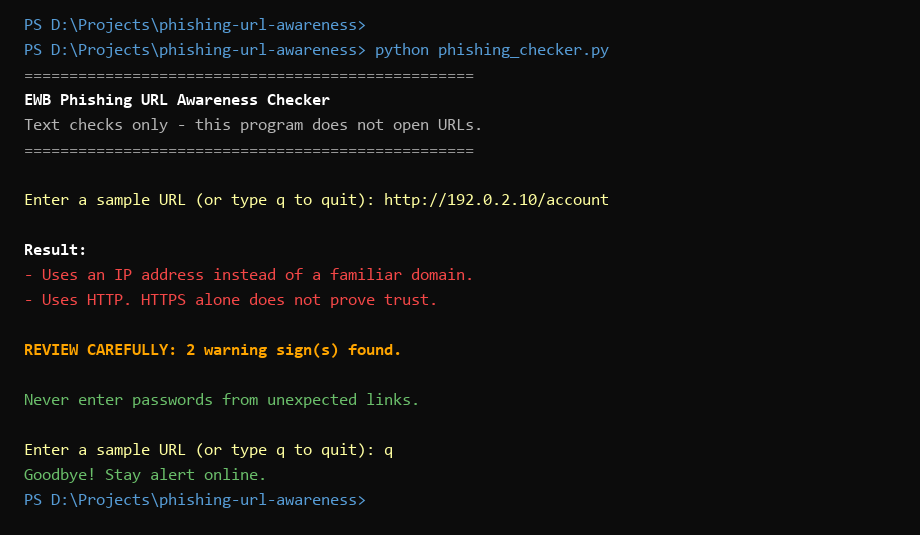
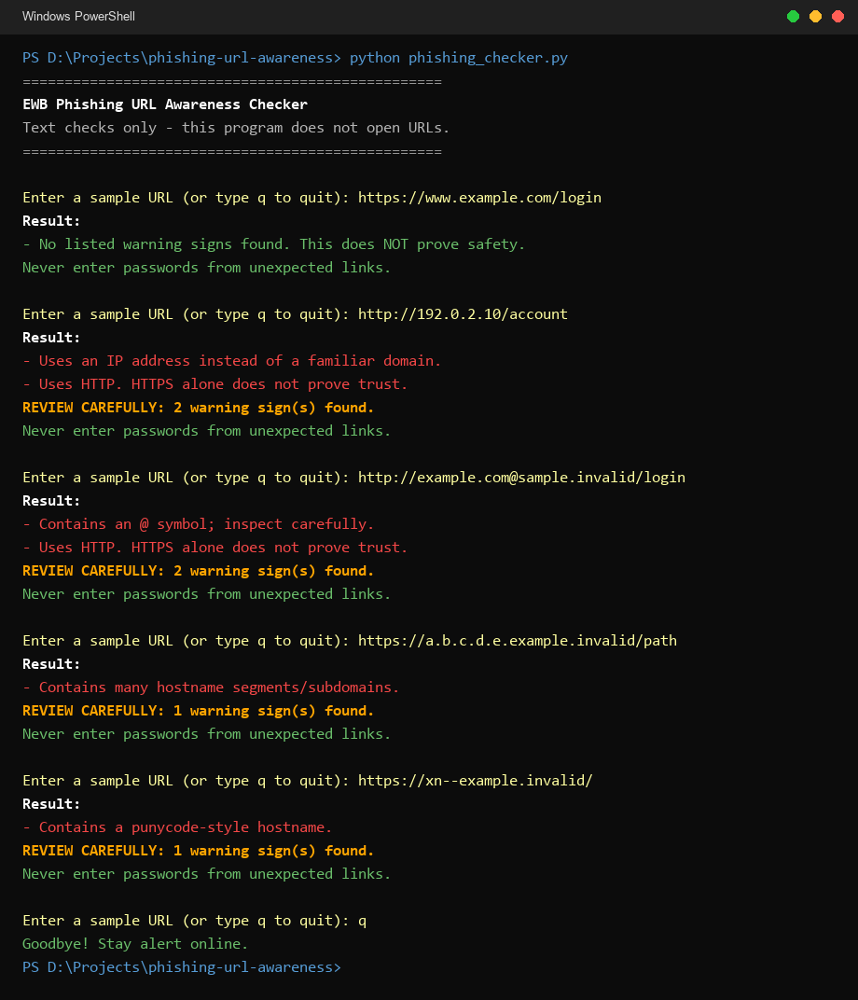
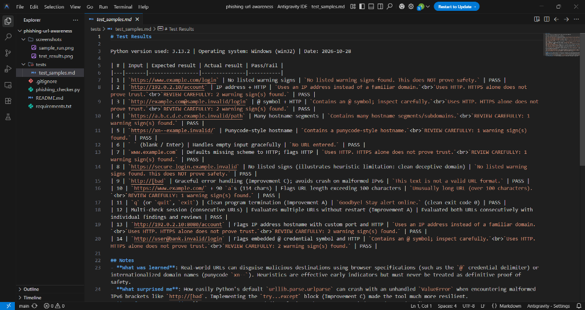

# EWB Phishing URL Awareness Checker

## Overview
Phishing is a social engineering attack where malicious actors craft deceptive links to impersonate legitimate services and lure victims into exposing sensitive credentials, OTPs, or financial details. The **EWB Phishing URL Awareness Checker** is a lightweight, defensive command-line tool written in Python that inspects the visible text structure of a given URL for common heuristic warning signs. Operating completely offline, this tool never visits links, scans websites, or sends network traffic.

## Features
The program analyzes URL text against six primary heuristic warning signs:
- **@ Symbol Detection**: Detects `@` inside the URL. Modern web browsers interpret characters before the `@` symbol as user credentials and route the connection to the host specified after it, allowing attackers to disguise the real destination.
- **Unusually Long URL Detection**: Flags URLs exceeding 100 characters in total length, a pattern frequently used to obscure malicious hostnames or push them beyond the visible address bar.
- **IP-Address Hostname Detection**: Identifies whether a raw IPv4 address is used directly as the hostname instead of a standard registered domain name.
- **Many Hostname Segments**: Flags hostnames containing 5 or more dot-separated parts (labels/subdomains), which attackers stack to create a deceptive appearance of authority.
- **Punycode Marker (`xn--`)**: Detects internationalized domain names prefixed with `xn--`, which can be exploited for homograph attacks using look-alike Unicode characters.
- **Unencrypted HTTP Scheme**: Warns when unencrypted `http://` is used, noting that while HTTPS provides transmission encryption, HTTPS alone does not guarantee a website is trustworthy.

### Added Improvements
- **Interactive Multi-Check Loop**: Allows users to inspect multiple URLs continuously in a single session without having to restart the script, exiting cleanly via `q`, `quit`, or `exit`.
- **"Review Carefully" Warning Summary**: Filters out purely informational notices (such as empty input or clean results) and displays a clear summary count (`REVIEW CAREFULLY: X warning sign(s) found.`) when genuine risk indicators are present.
- **Graceful Malformed-Input Handling**: Uses defensive exception handling (`try...except ValueError`) around `urllib.parse.urlparse` to intercept invalid URL formats (such as broken IPv6 literals like `http://[bad`) without crashing.

## Requirements
- **Python**: Version 3.10 or later (tested with Python 3.13.2)
- **Dependencies**: None. The project relies strictly on Python's built-in standard library (`urllib.parse`, `re`).

## How to Run

1. Open your terminal or command prompt.
2. Navigate to the project directory:
   ```bash
   cd path/to/phishing-url-awareness
   ```
3. Run the Python script:
   - **Windows**:
     ```bash
     python phishing_checker.py
     ```
   - **Mac / Linux**:
     ```bash
     python3 phishing_checker.py
     ```
4. Enter a URL when prompted. Type `q` and press Enter when you wish to quit.

## Example Output

```text
==================================================
EWB Phishing URL Awareness Checker
Text checks only - this program does not open URLs.
==================================================

Enter a sample URL (or type q to quit): http://192.0.2.10/account

Result:
- Uses an IP address instead of a familiar domain.
- Uses HTTP. HTTPS alone does not prove trust.

REVIEW CAREFULLY: 2 warning sign(s) found.

Never enter passwords from unexpected links.

Enter a sample URL (or type q to quit): q
Goodbye! Stay alert online.
```

## Testing

The program is evaluated against the 5 standardized benchmark sample URLs specified in the EWB project workbook, plus additional edge cases:

| # | Input | Expected Observation | Expected Finding Message(s) | Status |
|---|-------|----------------------|-----------------------------|--------|
| 1 | `https://www.example.com/login` | No warning signs | No listed warning signs found. This does NOT prove safety. | PASS |
| 2 | `http://192.0.2.10/account` | IP address + HTTP | Uses an IP address instead of a familiar domain. / Uses HTTP. | PASS |
| 3 | `http://example.com@sample.invalid/login` | @ symbol + HTTP | Contains an @ symbol; inspect carefully. / Uses HTTP. | PASS |
| 4 | `https://a.b.c.d.e.example.invalid/path` | Many hostname segments | Contains many hostname segments/subdomains. | PASS |
| 5 | `https://xn--example.invalid/` | Punycode-style hostname | Contains a punycode-style hostname. | PASS |
| 6 | ` ` (blank / Enter) | Empty input handling | No URL entered. | PASS |
| 7 | `www.example.com` | Missing scheme normalization | Defaults to HTTP; flags HTTP connection. | PASS |
| 8 | `https://secure-login.example.invalid` | Social engineering / deceptively clean name | No listed signs (illustrates heuristic limit). | PASS |
| 9 | `http://[bad` | Malformed URL handling (Improvement C) | This text is not a valid URL format (no crash). | PASS |
| 10 | `https://www.example.com/` + 90 `a`s (114 chars) | Excessive URL length (>100 characters) | Unusually long URL (over 100 characters). | PASS |
| 11 | `q` (or `quit`, `exit`) | Clean session exit (Improvement A) | Goodbye! Stay alert online. | PASS |
| 12 | Consecutive URLs in single run | Continuous inspection session (Improvement A) | Multiple URLs evaluated without program restart. | PASS |
| 13 | `http://192.0.2.10:8080/account` | Custom port + IP hostname + HTTP | IP address hostname and HTTP flags triggered. | PASS |
| 14 | `http://user@bank.invalid/login` | Credentials delimiter + HTTP | Contains @ symbol and HTTP flags triggered. | PASS |

> Complete test run details, including environment specifications and verbatim console outputs, are recorded in [tests/test_samples.md](tests/test_samples.md).

## Screenshots

### 1. Interactive Program Execution
Demonstration of running the CLI tool, inspecting a sample URL (`http://192.0.2.10/account`), displaying detected warning signs, showing the warning count summary, and exiting cleanly:


### 2. Multi-Sample Test Suite Execution
Demonstration of executing the benchmark URLs sequentially inside an interactive terminal session:


### 3. Test Evidence Table in IDE (VS Code)
Verification evidence showing the full 14-test verification table in `tests/test_samples.md` opened inside the editor:


## Improvements

1. **Continuous Inspection Session (Option A)**:
   - *What changed*: Wrapped user input handling inside a `while True` loop and added termination conditions for `q`, `quit`, and `exit`.
   - *Why*: In real defensive workflows, analysts inspect batches of suspected URLs. Re-launching the command-line program for each URL creates unnecessary friction.
   - *Verification*: Tested by feeding multiple URLs consecutively and confirming clean exit upon entering `q`.

2. **Actionable Threat Summary (Option B)**:
   - *What changed*: Created an `INFO_MESSAGES` tuple and a helper function `has_warnings()` to calculate the exact count of flagged risks and print a bold `REVIEW CAREFULLY: X warning sign(s) found.` banner.
   - *Why*: Helps users immediately recognize the difference between informational status notices (e.g., empty input) and detected risk indicators.
   - *Verification*: Tested against benign links (no review banner shown) and multi-flag URLs (banner correctly counts flags).

3. **Defensive Error Handling for Malformed URLs (Option C)**:
   - *What changed*: Wrapped `urlparse(candidate)` inside a `try...except ValueError` block.
   - *Why*: In standard Python, malformed URLs containing illegal brackets (such as incomplete IPv6 addresses like `http://[bad`) cause `urlparse` to raise an unhandled `ValueError`, crashing the application.
   - *Verification*: Passed `http://[bad` as input and confirmed the program outputs `"This text is not a valid URL format."` while remaining running in the interactive session.

## Limitations
- **Educational Scope**: This tool is an introductory text analyzer designed for learning URL anatomy and heuristic detection.
- **Text-Only Heuristics**: The program does not connect to the internet, resolve DNS records, verify SSL certificates, inspect page source code, or check threat intelligence reputation APIs (e.g., Google Safe Browsing, VirusTotal).
- **No False-Negative Guarantee**: Sophisticated phishing attacks regularly register clean, short domain names with valid HTTPS certificates (e.g., `login-update-service.com`). **"No listed warning signs found" does NOT mean a URL is safe.**

## Ethical Use
- **Defensive Learning Only**: This project is strictly designed for educational and defensive cybersecurity training.
- **Safe Testing Practices**: Only use documentation domains (`example.com`, `example.invalid`) and designated documentation IP ranges (`192.0.2.0/24`) for testing. Never interact with live, unverified malicious links.
- **No Malicious Use**: Do not use this tool to harvest credentials, craft deceptive URLs, or assess third-party infrastructure without explicit written authorization.

## Author
- **Author**: Mohammed Abdullah Mahmood
- **Email Id**: maabma28818@gmail.com 
- **Course**: EWB Cybersecurity Mini Project
- **Organization**: EWB Courses (EWB Edutech Private Limited)
